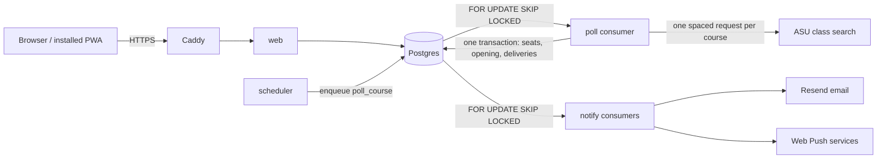

# Seatbell

Alerts for ASU students when a seat opens in a full class. Pick a section, or every section of a course, and get a push notification or email the moment one opens.

Independent student project, not affiliated with Arizona State University.

## How it works



`web` and `worker` are two processes from one image. Postgres is the only stateful dependency: it holds accounts, seat data, and the job queue.

## Design decisions

**Queue in Postgres, not Redis.** Detecting an open seat and enqueuing its delivery commit in one transaction, so a crash can't lose an alert or send one for a change that rolled back. Workers claim with `FOR UPDATE SKIP LOCKED`, leases recover jobs from crashed workers, every state change is fenced on the lease owner, and failures retry with jittered backoff before dead-lettering. At this scale a second datastore would add failure modes and buy nothing.

**Delivery is at-least-once with idempotent effects.** A unique index on (opening, watch, channel, device) means a delivery can be created only once. Email carries a provider idempotency key derived from that row. Push retries collapse on the device through a notification tag.

**Upstream load is independent of user count.** Each course is fetched once per cycle and shared by everyone watching it. A single consumer enforces a minimum gap between requests, and the revisit interval stretches as tracked courses grow, so the request rate has a fixed ceiling. All upstream traffic, including interactive search, goes through that consumer. 401, 403, 429, `Retry-After`, or repeated errors open a persistent circuit breaker. `POLLING_ENABLED=false` is a kill switch.

**Bad data is never read as "no seats."** A snapshot is parsed all-or-nothing, and malformed or partial responses are rejected without touching stored counts. Only a section previously seen full can "open," so first sightings and upstream blips can't produce false alerts. Per-watch cooldowns absorb flapping, and alerts older than 30 minutes expire rather than arrive late.

**Sign-in is a six-digit emailed code.** Magic links get pre-clicked by mail scanners and open in the wrong browser on iOS, which breaks installed PWAs. Codes are HMAC-hashed, single-use, expire in 10 minutes, and burn after five wrong guesses. Sessions are stored hashed and sent as `HttpOnly`, `SameSite=Lax`, `__Host-` cookies, with an Origin check on every mutation.

**One runtime dependency.** The server is `node:http`; Web Push (RFC 8291/8292) is `node:crypto`; TypeScript runs directly through Node's type stripping, so what's tested is what ships with no build step.

## Running it

Needs Node 22.18+ and Postgres 16.

```sh
npm install
createdb seatbell && createdb seatbell_test
cp .env.example .env   # set DATABASE_URL, and EMAIL_PROVIDER=log to print emails
npm run migrate
npm run dev:web        # in one terminal
npm run dev:worker     # in another

TEST_DATABASE_URL=postgres://localhost/seatbell_test npm test
```

| Command | What it does |
| --- | --- |
| `npm run probe -- CSE 310 2271` | Makes one real request and shows how it parses |
| `npm run stats` | Prints users, active users, alerts sent, and latency |
| `npm run vapid` | Generates Web Push keys |

Deployment is in [docs/DEPLOY.md](docs/DEPLOY.md) and the launch plan is in [docs/LAUNCH.md](docs/LAUNCH.md).

## Tests

The suite runs against real Postgres and covers concurrent claims across 16 workers, lease expiry and zombie fencing, atomic rollback, simultaneous snapshots, seat-transition rules, circuit breaking, the full HTTP flow, CSRF, code guessing, and access between users. Web Push encryption is checked by decrypting with the receiver's steps from the RFC.
